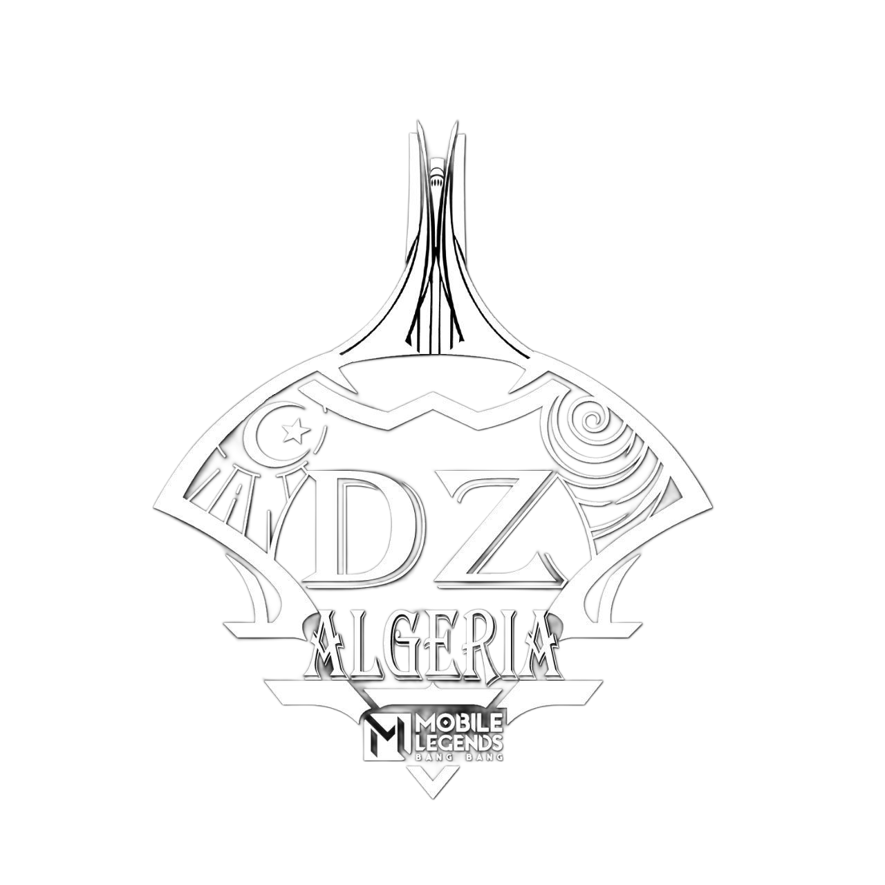
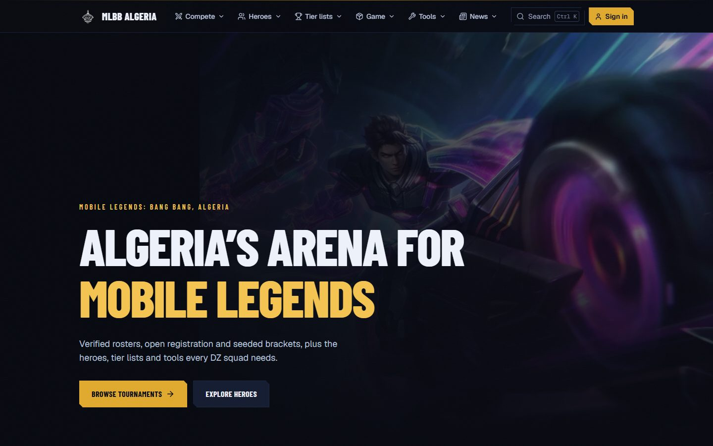
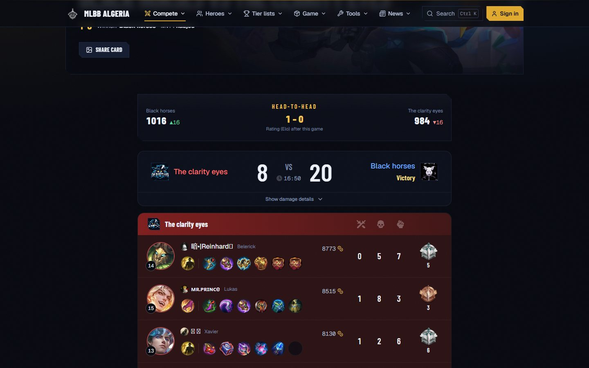
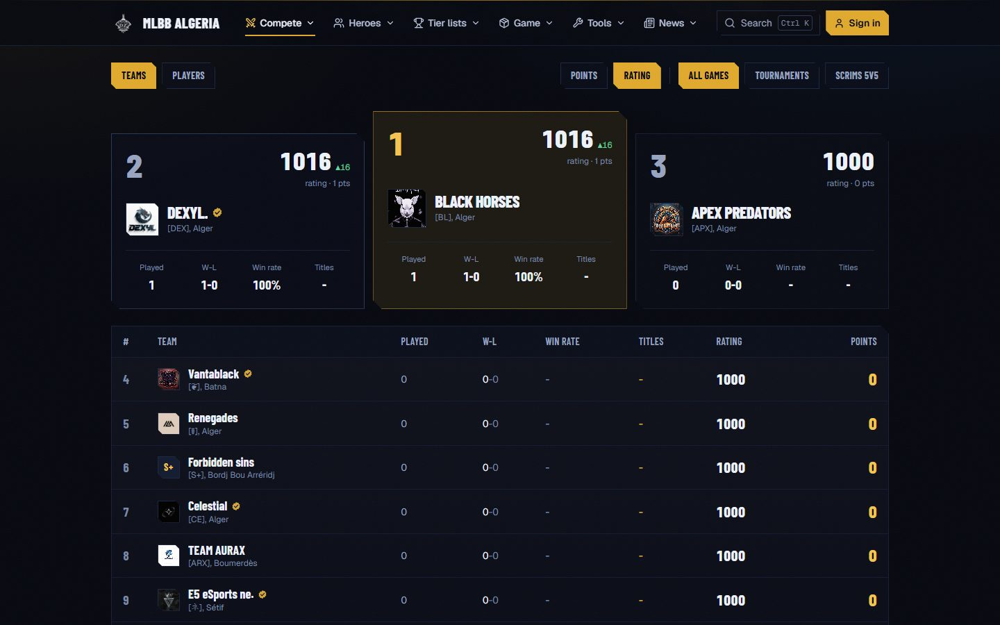
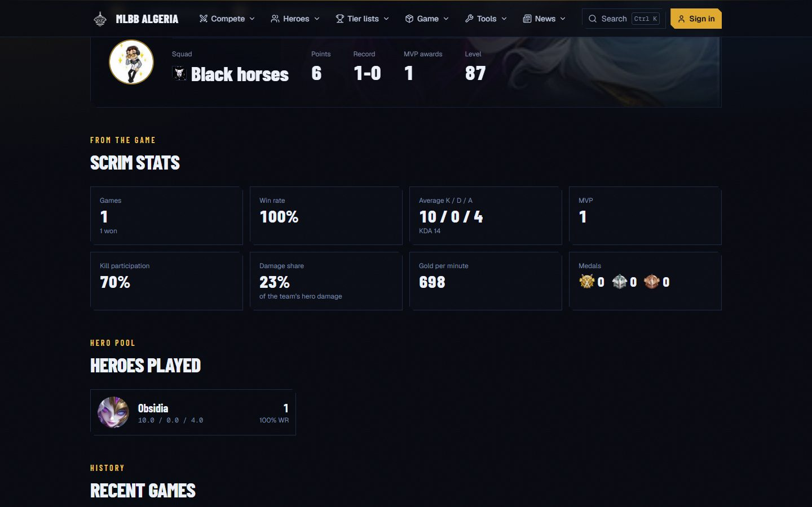
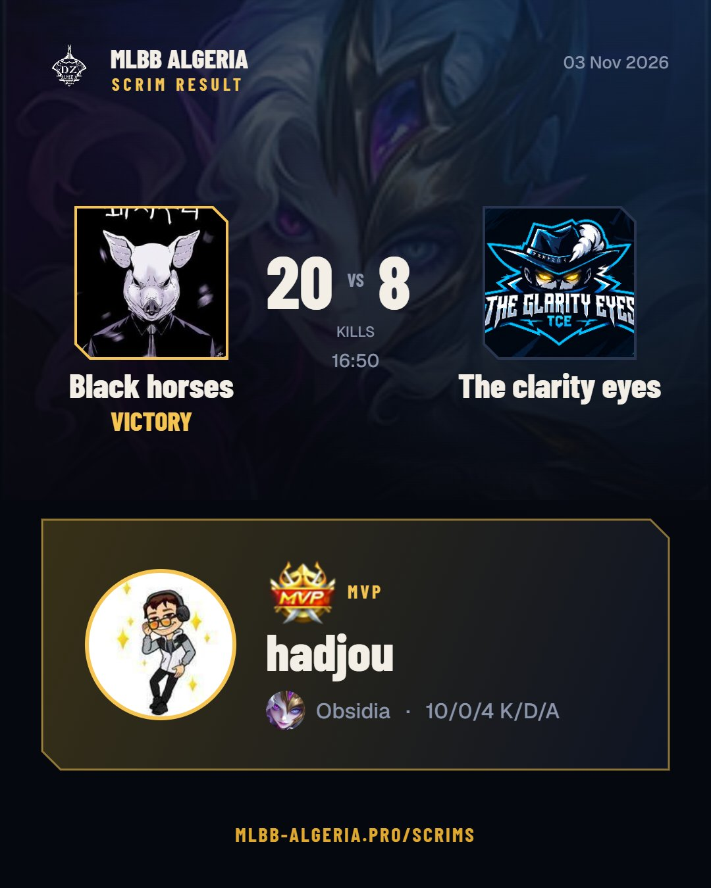
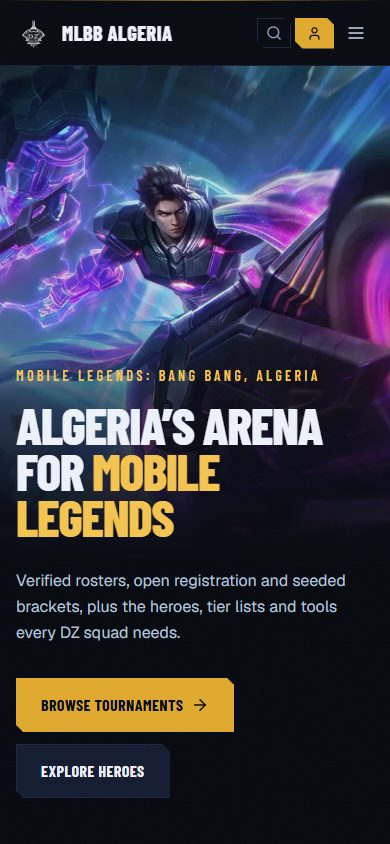
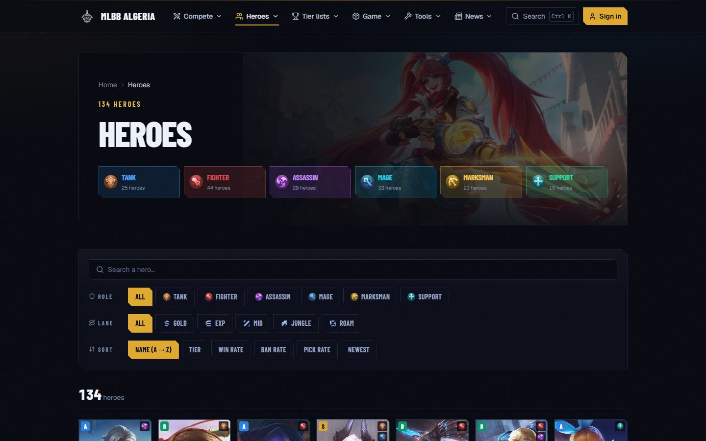

  

<h1 align="center">MLBB Algeria</h1>

  <b>Algeria's arena for Mobile Legends: Bang Bang</b> 
  منصة البطولات والسكريمات لمجتمع موبايل ليجندز في الجزائر 🇩🇿

  <a href="https://www.mlbb-algeria.pro"><b>www.mlbb-algeria.pro</b></a>
  &nbsp;·&nbsp; Discord: <b>mlbb-algeria</b>
  &nbsp;·&nbsp; Instagram: <a href="https://instagram.com/jaaxxys"><b>@jaaxxys</b></a>

  

MLBB Algeria is a community-run website where Algerian Mobile Legends players build their squads, play scrims and
tournaments, and climb the season rankings. Every player signs in with their real in-game account, so rosters are
real, results are read straight from the game, and the rankings reflect who actually wins.

It is also a full Mobile Legends wiki and toolbox: every hero with builds and counters, tier lists, statistics, patch
notes and tools for drafting and practice.

---

## ⚔️ Scrims: challenge any squad, the game does the rest

A squad leader challenges another squad from the site. When the other leader accepts, the site opens a real custom
lobby in the game. Both rosters take their 5 seats on the lobby page, the **Open lobby in game** button appears for
the 10 players, and they play.

When the game ends, the site reads the scoreboard from the game by itself: the winning squad, the MVP, every hero,
K/D/A, items and medals. Points and ratings update within a minute, and the result is published for everyone.

  

- **No screenshots, no arguing:** the result comes from the game, not from the players.
- **Only the 10 players get the game link,** once both squads are full. The public link only shows the lobby page.
- **Staff lobbies:** admins can open a lobby between any two squads (or two picked at random), ranked or just for fun.
- **Open lobbies:** a lobby anyone can join, no squad needed: take a seat on the red or blue side, first come.
- **Notifications** on the site when your squad is challenged or a lobby opens, and updates in the community Discord.

## 🏆 Rankings, ratings and head-to-head

  

- **Season points** for every confirmed result: tournament wins, scrim wins, titles, and +5 for the MVP.
- **Squad rating (Elo):** every squad starts at 1000, and beating a stronger squad is worth more than beating a weaker
  one. Switch the rankings between points and rating.
- **Head-to-head:** every result shows the record between the two squads and how much rating each one won or lost.

## 🎮 Player career pages

Click any player to see their career: rank, squad, points and MVP awards, plus stats from every scrim they played on
the site — win rate, K/D/A, kill participation, damage share, gold per minute, medals, hero pool and recent games.

  

## 🖼️ Share cards

Every result has a **Share card** button: a ready-made 1080 × 1350 image with both squad logos, the score and the MVP,
to download or send straight to WhatsApp, Instagram or Discord.

<table>
  <tr>
    <td width="45%"></td>
    <td width="55%">
      <h3>Made for phones too</h3>
      Everything works on a phone: sign in, take your seat, open the game, share the result.
        
      
    </td>
  </tr>
</table>

## 🏟️ Tournaments and squads

- **Sign in with your Mobile Legends account.** Your in-game name, rank and avatar come from the game and stay in sync,
  so nobody can fake a roster. One account per player.
- **Create a squad** (name, tag, logo, wilaya), invite your teammates with a private link, and get approved by staff.
- **Register for tournaments** and follow the seeds, brackets, schedule and scores.
- **Verified** badges for pro players and squads.
- **Staff panel** to approve squads, run tournaments and brackets, record results, manage lobbies and publish news.

## 📚 Wiki and tools

  

- **Heroes:** all 134 heroes with builds, counters, duos, skills, skins and lore.
- **Tier lists and statistics** from live win, pick and ban rates, plus a **tier list maker** to share your own.
- **Items, emblems, spells, game modes,** patch notes, Advance Server changes, events and esports.
- **Tools:** draft helper, team builder, hero compare, win-rate calculator, draw calculator, objective timer,
  Retribution trainer, server clock and a daily **MLBBdle** guessing game.
- Game data is synced every day, so the wiki follows each patch.

---

## Built with

React, TypeScript, Vite and Tailwind CSS on the front; Supabase (Postgres, auth, storage) for accounts and results;
serverless functions on Vercel for the game services. Scrim lobbies and results use the custom-match tool behind
Mobile Legends' own match page.

## Community

Join the Discord (**mlbb-algeria**) to find squads, follow scrims and get every update first.
Bugs and ideas are welcome: open an issue on this repository.

MLBB Algeria is a fan-made community project. Mobile Legends: Bang Bang and all related artwork are trademarks of
Moonton; this site is not affiliated with or endorsed by Moonton. Game data comes from public community sources.
Interface inspired by mlbbdex (achedon12/mlbb, MIT).

